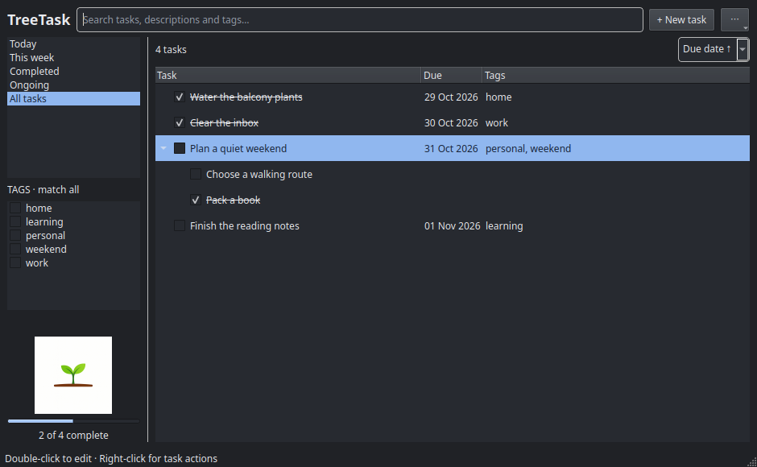

# TreeTask

A minimal native desktop task manager, using the same Qt toolkit and compact
layout as Idea. Check off tasks, sort by due date, and watch a small plant grow.
Your descriptions, tags, and subtasks stay in SQLite on your computer.



## Quick start

Requires Python 3.10+ and a desktop with Qt support. PySide6 is installed automatically.

```bash
python3 -m venv .venv
.venv/bin/python -m pip install .
.venv/bin/treetask
```

Choose **Today**, **This week**, **Completed**, **Ongoing**, or **All tasks**.
**Ongoing** is the default. Tasks sort by due date; use the date dropdown to reverse
that order. Double-click a task to edit it, or right-click for subtasks and actions.

See the [user guide](docs/user-guide.md) for desktop installation, shortcuts,
search, tags, existing-data compatibility, and development checks.

[MIT license](LICENSE).
