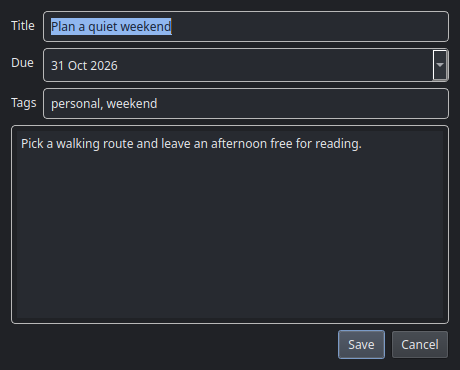

# TreeTask user guide

[Back to README](../README.md)

TreeTask is a native Qt desktop application. It runs locally without a web server
or browser. Run the commands below from the repository root.

## Install and launch

Requires Python 3.10+ and a desktop with Qt support.

```bash
python3 -m venv .venv
.venv/bin/python -m pip install .
.venv/bin/treetask
```

You can also run `.venv/bin/python -m treetask`.

For a per-user Linux application-menu launcher and isolated installation:

```bash
python3 scripts/install-desktop.py
```

Run the same command to update it. Open **TreeTask** from the application menu,
search for **task** or **todo**, or run `~/.local/share/treetask/venv/bin/treetask`.
The installer retains compatibility with older TreeTask desktop shortcut commands.
The native app reuses `~/.treetask/tasks.db`, including existing tasks and subtasks;
older databases gain empty description and tag fields automatically.

When moving from the browser version, close its UI and stop its old background
server/panel helper before replacing that installation. Development on this branch
does not replace your separately installed copy.

## Views and sorting

- **Today**: tasks due today, including completed tasks.
- **This week**: tasks due Monday through Sunday of the current calendar week.
- **Completed**: all finished tasks.
- **Ongoing**: all unfinished tasks, regardless of due date; the default view.
- **All tasks**: every task.

Tasks sort by due date, earliest first. The date dropdown reverses the order.
Equal dates have a stable order by task ID. This week uses a calendar week rather
than the browser version's rolling date range.

## Tasks and subtasks

Click **+ New task** or press **Ctrl+N** / **Alt+Shift+N**. Enter a title and due
date, with optional description and comma-separated tags. Duplicate tags ignore
case, preserving the first spelling. **Ctrl+Enter** saves the dialog; Cancel or
Escape discards its unsaved changes.



Use each row's checkbox, or select a row and press **Space**, to toggle completion.
Double-click to edit. The **⋯** menu and right-click menu contain edit, add-subtask,
and delete actions. Delete asks for confirmation; deleting a parent also deletes
its subtasks. Parent and subtask completion remain independent. Expand a parent
row to show its subtasks. Descriptions and tags belong to parent tasks.

The small plant and progress summarize the selected view, ignoring search/tag
filters. Ongoing therefore shows no completed tasks in its progress count.

## Search and tags

Search matches task titles, descriptions, and tags without regard to case.
Select tag checkboxes in the sidebar for exact matches; multiple selected tags
must all be present on the task. Search and tag filters combine with the view.
Available tags come from all tasks, and selections survive view changes. Removed
tags are dropped from the selection; the tag section hides when no tags exist.

## Panel icon and global shortcut

After desktop installation, optional GNOME setup:

```bash
/usr/bin/python3 scripts/setup-panel.py
```

This uses the installed `desktop-keybindings` command and GNOME's panel indicator
support; it does not install system components. Setup refuses to overwrite an
unrelated custom shortcut. **Super+Shift+T** opens TreeTask from any application,
reusing the running window. Super is the Windows key.
**Ctrl+Alt+Shift+N** opens quick-add from any application. It shows only the task
dialog when TreeTask is hidden or not yet running. Repeating the shortcut focuses
the existing new-task dialog without discarding its contents. Idea's Ctrl+Alt+N
and the terminal's Ctrl+Alt+T remain unchanged.

The panel menu offers **Open TreeTask**, **+ New task**, **Keyboard shortcuts**,
and **Quit TreeTask**. Closing the window leaves the app in the panel when tray
support is available. Quit from **⋯ → Quit TreeTask** or the panel menu to exit.
**Ctrl+W** closes the main window, retaining its panel icon when available. In a
task dialog, Ctrl+W cancels that dialog, like Escape.
Without tray support, closing the window exits. Login startup uses
`~/.config/autostart/treetask.desktop`; remove it to disable startup.

The following command-line modes are also available:

- `treetask --tray`: start in the panel; show a window if no tray is available.
- `treetask --no-tray`: closing the window exits.
- `treetask --capture`: open a new-task dialog in the existing instance.
- `treetask --database /path/to/tasks.db`: use a separate database.

Only one native instance opens each database. Activation uses a same-user local
socket, without an HTTP port. The installed package lives in
`~/.local/share/treetask/venv`; panel startup output goes to
`~/.local/share/treetask/tray.log`.

## Keyboard shortcuts

| Shortcut | Action |
| --- | --- |
| Super+Shift+T | Open TreeTask from any app after GNOME setup. |
| Ctrl+Alt+Shift+N | Quick-add a task from any app after GNOME setup. |
| Ctrl+N / Alt+Shift+N | New task. |
| Ctrl+W | Close the window, or cancel the task dialog. |
| Alt+Shift+D | Finish the selected task or subtask. |
| Space | Toggle the selected checkbox. |
| Ctrl+F | Focus search. |
| Ctrl+Enter | Save the task dialog. |

The full list is available under **⋯ → Keyboard shortcuts** and in the panel menu.

## Development

```bash
.venv/bin/python -m pip install -e .
QT_QPA_PLATFORM=offscreen .venv/bin/python -m unittest discover -s tests -v
QT_QPA_PLATFORM=offscreen .venv/bin/python scripts/screenshots.py
```

Tests and screenshots use temporary databases. Socket tests require permission
to create local Unix sockets. The screenshot script renders fictional tasks and
never reads your task database. Qt's offscreen plugin may print platform warnings.

## License

[MIT](../LICENSE).
